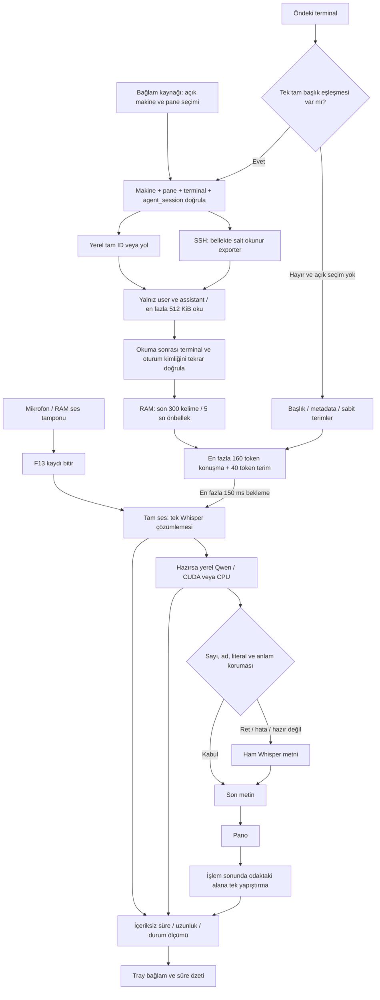

# VoiceDictation mimarisi

Ses Windows'ta yerel Whisper ile çözülür. Konuşma bağlamı Whisper'a kısa bir ipucudur; yazının gideceği
alanı seçmez. Son metin çözümleme ve temizlik bittiğinde odaktaki alana pano üzerinden yapıştırılır.
Dikte sonunda otomatik Enter yoktur; Windows boşta F13 çift hızlı basış ayrı ve açık Enter hareketidir.

Kaynak kontrolü arka planda yaklaşık 0,75 saniyede bir çalışır, Herdr envanteri yaklaşık 15 saniyede
yenilenir. Genel başlıktan “en yeni” veya sunucuda o an odaktaki oturum tahmin edilmez. Tek bir tam
başlık eşleşmesi yoksa **Bağlam kaynağı** menüsünden seçim gerekir. Manuel seçim uygun terminal
penceresinin hwnd/PID kimliğine bağlanır; Chrome veya başka pencerede kaynak kullanılmaz. Aynı pencere
içindeki sekme değişimi algılanmadığından açık seçim güncellenmelidir.

`agent_session`, sağlayıcı (`codex`/`claude`), tür (`id`/`path`), değer ve kaynak alanlarıyla doğrulanmış
oturum kaydını belirtir. Herdr'ın mevcut oturum başlangıç hook'ları bu alanı verebilir; eski oturumlar
kayıtsız olabilir. Terminal süreç argv'si tek başına sohbet kimliği sayılmaz. `context_bridge.py`
yalnız tam ID/yol çözümlemesi yapar; alt ajan, sistem ve araç metinlerini dışlar. `context_source.py`
yerel/SSH okumayı kimlik kontrolü ve RAM önbelleğiyle yönetir. Uzak exporter stdin üzerinden çalışır;
uzak makineye dosya yazmaz veya paket kurmaz. Herdr terminal çıktısı, ilgisiz oturum veya rastgele son
değişen kayıt okunmaz.

Whisper'ın ipucuna 300 kelimenin tamamı girmez. Gerçek HF tokenizer ile konuşmanın son kısmı 160,
terimler 40 token ile kesilir; toplam en fazla 200 token, 223 sınırının altındadır. Tokenizer olmayan
Mac yolunda daha muhafazakâr UTF-8 byte sınırı kullanılır. Bağlam için ayrı bir dil modeli çalışmaz.
Kaynak hazır değilse veya kimlik değişmişse genel ipuçlarıyla dikte devam eder.

Qwen ayrı kalıcı yerel alt süreçtir. Mevcut model CUDA0 doğrulanırsa GPU'ya yüklenir; başlatma,
ön ısıtma veya çalışma zamanı GPU hatasında CPU yedeği vardır. Hazır olmayan model bekletmez; ham
metin korunur. Temizlik en fazla 1200 karakter ve 12 saniye ile sınırlıdır. Normal kapanış yalnız
uygulamanın sahip olduğu süreci kapatır.

**Uzak dikte (Vault, iPhone/iPad):** `remote_dictation.py` daemon içinde yalnız `127.0.0.1:5190`'da dinler.
Tek istemcisi iFonzo canlı ajan grafının terminal köprüsüdür (`memory/garden/tools/dikte.cjs`). Tailscale kimliği ve
HTTPS orada çözülür; uç ayrıca `X-Vault-Dikte` başlığı ve `127.0.0.1` Host'u ister.

- `POST /hazirla?pane=&makine=` kayıt başında gelir. Pane Herdr'dan doğrulanır, makine etiketi profil kimliğine
  çevrilir. Sohbet bağlamı ayrı bir `ContextCache`'te en çok 90 sn tazelenir; yerel izleyicinin önbelleği değişmez.
- `POST /dikte` gövdesi 16 kHz mono 16-bit PCM'dir. Akış aynı `quick_transcribe` ve `_cleanup_text`'tir; pano,
  yapıştırma ve Enter yoktur, metin yanıtla döner. Ses diske yazılmaz. Ölçüm satırı `source: vault` taşır, aylık log
  yerel dikteyle aynı politikadadır.

Konuşma bağlamı için yeni transkript veya günlük kopyası oluşturulmaz. `.local/metrics/dictation.jsonl`
yalnız süre/uzunluk/durum ve izin verilen backend değerini tutar; konuşma, pencere/pane adı içermez.
Mevcut aylık dikte log politikası ayrıdır. Yerel dosyaların tam listesi
[README tablosunda](../README.md#yerel-dosyalar), kullanıcı akışı [nasıl çalışır](nasil-calisir.md) belgesindedir.
