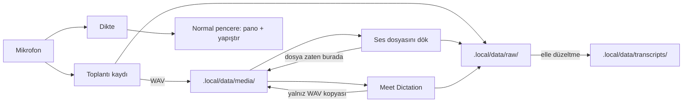

# VoiceDictation nasıl çalışır

Bu belge dört kullanım akışını, tray menüsünü, çıktı biçimini ve transkript temizliğini anlatır. Kurulum ve başlatma için [kurulum.md](kurulum.md), dosya konumları için [README → Yerel dosyalar](../README.md#yerel-dosyalar) bölümüne bak.

## Genel bakış

Uygulama, arka planda çalışan tek bir süreçtir (`dev/dictation.py`). Mikrofonu sürekli dinler; dört akıştan birini başlatan komutu bekler.

Geliştirme dosyaları tek `dev/` ağacındadır: Python/C kaynakları, `dev/scripts/` başlatıcıları, `dev/tests/` testleri ve `dev/requirements.txt`. Kökte Python dosyası yoktur; uygulama `python -m dev.dictation` ile başlar. Makineye özel her şey `.local/` altındadır: veriler `data/`, ortam `venv/`, önbellek `__pycache__/`, ayarlar `.env`, modeller ve loglar kendi alt klasörlerindedir. Başlatıcılar çalışma dizinini repo köküne alır.

Kurulum arşivleri çalışırken kullanılmaz; Windows'taki eski ZIP dosyaları ve tamamlanmış deneme artıkları temizlendi. Modeller, çalıştırıcılar ve tanı logları `.local/` altında korunur. Python önbelleği gerektiğinde yeniden oluşabilir; test geçici dosyaları `.local/test-tmp/` altındadır.

Mac'te menüden Çıkış, Cocoa uygulamayı sonlandırmadan önce trackpad'i, tanı yazıcısını, sahip olunan Qwen sürecini ve PID kaydını kapatır. Böylece her yeniden açılışta eski model süreçleri bellekte birikmez. Klasör geçişinin geri dönüş kayıtları `.local/migration-YYYYMMDD/` altında tutulur.

Mac'te otomatik yapıştırma için yeni başlatıcının Erişilebilirlik izni gerekir. İzin yoksa metin panoya alınır ama `⌘V` gönderilmez; tanıda `permission_denied`, menüde “Klavye izni eksik — metin panoda” görünür. Bitiş tonu durdurmada zaten çalmıştır; yapıştırma yapılmaz. İzin varken tuş gönderimi, hedef uygulamanın metni gerçekten kabul ettiğinin tek başına kanıtı değildir; gerçek kullanım ayrıca doğrulanır.



Program yalnız `.local/data/media/` ve `.local/data/raw/` klasörlerine yazar. `.local/data/transcripts/` elle yönetilir: ham transkripti düzeltip oraya alan Yiğit'tir (aşağıda [Elle düzeltme](#çıktı-biçimi)).

| Akış | Başlatma | Kalıcı çıktı | Kaynak dosyaya ne olur |
|---|---|---|---|
| Dikte | F13 / Caps Lock x2 / "Diktasyon" | Yok (son metin hedefe yazılır; Enter gönderilmez) | — |
| Toplantı kaydı | Tray → 🎤 Toplantı → Başlat | `.local/data/media/<ad>.wav` + `.local/data/raw/<ad>.md` | — |
| Ses dosyasını dök | Tray → 📁 veya `--transcribe FILE` | `.local/data/raw/<dosya adı>.md` | `.local/data/media/` içindeyse **yerinde kalır**; dışındaysa oraya **taşınır** |
| Meet Dictation | Tray → 🎥 | `.local/data/media/<ad>.wav` + `.local/data/raw/<ad>.md` | **Dokunulmaz**, yerinde kalır |

## Dikte

### Ayrıntılı tanı ve karşılaştırma

Yiğit'in isteğiyle her tamamlanan/işlemeye alınan dikte `.local/diagnostics/YYYY-MM-DD.jsonl` içine ortak `trace_id` ile kaydedilir. Bu dosya **metin içerir**: başlangıç penceresi ve seçilmiş pane, doğrulanmış sohbet kimliği ve bağlam durumu, kullanılan bağlam, Whisper'a gerçekten gönderilen prompt/hotwords, ham ve filtrelenmiş cevap, Qwen'e gönderilen tam prompt ve aday cevap, seçilen metin ve pano içeriği. Model çalışmazsa ilgili istek/cevap bölümü oluşmaz; sebep durum alanlarında görünür. Tek-nefes wake akışında önceden çözülmüş metin kullanıldığı `direct_text` ile belirtilir; önceki dinleme çözümlemesi bu dikte kaydına bağlanmaz.

Ctrl+V öncesi/sonrası odaktaki pencere kaydedilir. Hedef pane yalnız tekil tam başlık eşleşmesi varsa aday olarak gösterilir; manuel **bağlam kaynağı** hedef pane sayılmaz. Pencere içi imleç/sekme veya uygulamanın metni kabul ettiği kesin bilinmez; `keyboard_event_only` bunu belirtir. Açık çift F13 Enter ayrıca `operation: enter` olayıdır; hangi metni gönderdiği varsayılmaz. Kayıt başlamadan elenen tuşlar ve resetle işlemeye geçmeden iptal edilen sesler için tam dikte kaydı oluşmaz.

Kimlikler, metin ve süreler günlük dosyada yereldir; ham ses, yetkilendirme başlıkları ve API anahtarları eklenmez. Eski içeriksiz süre dosyası korunur ve `trace_id` ile eşleşir; bağlam yokken `context_words: 0` açıkça yazılır. Yazma sınırlı bir arka plan kuyruğundadır; kuyruk taşması ve dosya hatası sayaçları `writer_health` alanındadır. Dikteyi disk yazımı için bekletmez. Her uygulama açılışı `run_id`, çalışan kaynak kod özeti `build` ile ayrılır; dosyalar kendiliğinden silinmez.

Son 100 olayı kaynak makine/pane, kod sürümü ve bağlam durumuna göre, konuşma metnini ekrana dökmeden karşılaştır:

```powershell
.local\venv\Scripts\python dev\scripts\compare-dictation.py --last 100
```

Özet; örnek sayısı, temizlik kabul/ret durumları ve ses uzunluğu, metin uzunluğu, bağlam kelimeleri, toplam/Whisper/temizlik/yapıştırma sürelerinin ortanca ve en yüksek değerlerini verir. Farklı uzunluk ve ses koşullarındaki kayıtların hızları doğrudan eşdeğer sayılmaz. Yalnız yeni kayıtlar bu ayrıntıları taşır.

Görsel anlatım: [etkileşimli HTML şeması](dikte-akisi.html). Model promptları, kaynak sınırları ve GPU/RAM ayrımı açılır bölümlerde gösterilir.

Başlangıç tonu kayıt açılınca, bitiş tonu (eski ikili tamamlanma tonu) kayıt durdurulduğu anda çalar; ekrana bakmadan kaydın bittiği duyulur. Sonraki yapıştırma sessizdir. Boş/hatalı sonuçta ayrıca hata tonu çalar. Tonlar eski Windows çalma yolunu kullanır. Bağlam durumu Windows'ta sağ alttaki VoiceDictation simgesinin sağ tık menüsünde ve simgenin üzerine gelince açıklama balonunda görünür; bağlam değişince yenilenir.

Durum makinesi `LISTENING → RECORDING → PROCESSING → COOLDOWN → LISTENING` sırasıyla ilerler. Ses yalnız RAM'de tutulur ve metne çevrildikten sonra silinir.

1. **Başlat:** F13 (Windows) veya Caps Lock x2 (macOS) tuşuna bas ya da açıkken "Diktasyon" de. Kayıt sesi çalar, simge kırmızıya döner. Bağlam ipucu için o andaki pencere başlığı veya seçilmiş salt okunur Herdr kaynağı alınır.
2. **Konuş:** Ses birikir. Geçici çözümleme, canlı dikte önizlemesi ve terminale canlı taslak yazımı yoktur. Sessizlikte kayıt kendiliğinden gönderilmez. Başlangıçta 30 saniye hiç konuşma algılanmazsa kayıt iptal olur.
3. **Bitir:** Aynı tuşa bas ya da tekrar "Diktasyon" de. Whisper turbo (`beam=3`) kaydın tamamını bir kez çözer. Bitiş tonu durdurma anında çalar. Yerel temizlik açıksa uygulandıktan sonra metin panoya alınır ve **işlem bittiğinde odaktaki alana** sessizce bir kez yapıştırılır. Kayıt başındaki pencereye veya Herdr pane'ine kilitlenmez. **Enter gönderilmez; metni kontrol edip Enter'a sen basarsın.**
4. **Bekleme:** 1,5 saniye sonra dinlemeye döner.

- **Windows F13 tek/çift basış:** Boşta ilk tuşa basıldığı anda ses RAM'e kaydedilir. Tuş bırakıldıktan
  sonra yalnız başlangıç tonu 250 ms bekler. Hızlı çift basışta kısa kayıt, ton/çözümleme/yapıştırma
  olmadan atılır; aynı pencere doğrulanırsa bir Enter gönderilir. İkinci basış gelmezse eski başlangıç
  tonu çalar, bağlam/wake kontrolü başlar; ton öncesindeki ses korunur. Tonu beklemeden konuşulabilir.
  Bu kullanıcının açık gönderme hareketidir; dikte bitişinin otomatik parçası değildir.
  Kesinleşmiş kayıt sırasında basış beklemeden kaydı durdurur. İşleme
  sırasında F13 Enter göndermez. Mac Caps Lock çift/üç basış davranışı değişmez.
- **Tek nefes:** Wake word açıkken "Diktasyon <mesaj> Diktasyon" dersen metin aynı pano/yapıştırma yolunu kullanır; Enter gönderilmez.
- **Yalnız wake word:** Mesaj olmadan yalnız "Diktasyon" algılanırsa kayıt iptal edilir.
- **İptal:** Windows'ta F13'ü 1,25 saniye basılı tut; macOS'ta Caps Lock'a üç kez bas. Tray → ↺ Sıfırla da aynı işi yapar. İptal, sürmekte olan model işleminin sonradan yazmasını engeller; daha önce yapıştırılmış metin geri alınmaz.
- **Wake word:** Varsayılan kapalıdır; Tray → ⚙ Ayarlar → Anahtar Kelime Dinleme ile açılır. "Anahtar Kelime: … (değiştir…)" ile değiştirilebilir. Seçim RAM'dedir, yeniden başlatınca "diktasyon"a döner.
- Odağı kayıt veya çözümleme sırasında değiştirirsen metin son odaktaki alana gider. Herdr seçimi bir teslimat adresi değildir; doğrudan Herdr yazımı ve terminal komutları kullanılmaz.

### Bağlam ipuçları ve kayıtlı konuşma

Tanınan terminal/editörün başlığından kısa terimler alınır. Herdr kaynak envanterinde pencere başlığı
**tek bir pane başlığıyla tam eşleşiyorsa** kaynak otomatik seçilebilir. Mac'te başlık yerine Terminal
başlığındaki `<bu Mac>: <çalışma alanı>` ile Herdr'ın odaklı pane'i birlikte doğrulanır
([mimari](mimari.md)); ilk kullanımda macOS “Terminal'i denetleme” (Otomasyon) izni sorar. Genel veya belirsiz başlıkta
kaynak tahmin edilmez; Windows tray → **Bağlam kaynağı** menüsünden doğru makine/pane açıkça seçilir.
Konuşma kaynağı seçimi yalnız tanınan terminal uygulamalarında yapılır; editör başlığı tek başına
konuşma oturumuna bağlanmaz, yalnız kısa terim ipucu olabilir.
Windows Terminal gibi terminal pencereleri de desteklenir. Seçim uygun terminal penceresinin hwnd/PID
kimliğine bağlanır; başka pencere/Chrome'da kullanılmaz. Aynı pencere içi sekme değişimi algılanmaz;
manuel kaynağı yeniden seçmek gerekir. Bu seçim **yapıştırma hedefi değildir**; son metin işlem sonunda
odaktaki alana gider.

Kaynakta kayıtlı `agent_session` kimliği varsa yalnız bu tam ID veya doğrulanmış yoldaki Codex/Claude
konuşması okunur. Makine, pane, terminal ve oturum kimliği okumadan önce/sonra doğrulanır. Yalnız
`user` / `assistant` görünen metni, son **en fazla 300 kelime** ve **512 KiB okuma sınırı** kullanılır;
araç/sistem metni ve alt ajan kayıtları dışlanır. Rastgele “en yeni oturum” aranmaz. İlgisiz görev
kayıtları bağlam yapılmaz. Mevcut Herdr oturum başlangıç hook'larının verdiği `agent_session`
alanı kullanılır; global hook değişikliği yapılmaz. Eski oturumun kimliği kayıtlı değilse genel bağlama dönülür.

Whisper ajan yanıtlarının biçimini dikteye kopyalayabildiği için görünen metin kelime sınırından önce sadeleşir:
`karar:`, `soru:`, `bilgi:` etiketleri; Markdown vurgu, başlık, alıntı, liste, tablo ve backtick işaretleri atılır,
kelimeler kalır. `<task-notification>`, `<local-command-stdout>` ve `<local-command-stderr>` blokları içerikleriyle
dışlanır; diğer etiketlerde (`<pasted_content>` gibi) yalnız etiket gider. Yerel, SSH ve Vault yolu aynı temizliği kullanır.

Yerel kaynak doğrudan, uzak kaynak mevcut SSH bağlantısında belleğe verilen salt okunur Python
exporter ile okunur. Uzakta paket kurulmaz ve dosya yazılmaz. Konuşma metni yeni loga/transkript
kopyasına yazılmaz; RAM önbelleğinde tutulur. Arka plan izleyici yaklaşık 0,75 saniyede bir kaynak
kontrol eder, envanter yaklaşık 15 saniyede yenilenir; önbellek geçerliliği 5 saniyedir. Dikte
bağlam için en fazla 150 ms bekler; kaynak hazır değilse başlık/metadata veya sabit ipuçlarıyla devam eder.

Konuşmanın tamamı Whisper'a verilmez. Son konuşma ya da sabit terim listesi **160 token**, terim
ipuçları **40 token**, toplam en fazla **200 token** ile sınırlanır; bu 223 token bütçesinin altındadır.
Windows'ta faster-whisper, Mac'te `mlx_whisper` tokenizer'ı sayar; tokenizer yüklenemezse muhafazakâr
UTF-8 byte sınırı kullanılır. (25 Ekim 2026'ya kadar Mac hep byte sınırındaydı ve sabit listenin yarısı
kesiliyordu.) Sabit listede sık kullanılan terimler baştadır; bütçe aşılırsa sondakiler düşer. faster-whisper `initial_prompt`
ve `hotwords`, MLX `initial_prompt` alır. Bağlam için ayrı model çalışmaz. Wake algılama ve dosyadan
transkripte masaüstü konuşma bağlamı eklenmez.

Konuşma yoksa pane etiketi/cwd'nin son adı ve uygun yerel Git dalı veya varsa uzak metadata dalı
terim olabilir; uzak yol üzerinde yerel Git çalıştırılmaz. Tray **Bağlam: sohbet (… kelime)**,
**genel dikte** veya **sohbet kimliği/metni hazır değil** durumunu gösterir. Mimari ve kaynak/çıktı
ayrımı [mimari.md](mimari.md), doğrulama sınırları [oturum kaydındadır](sessions/2026-10-24-conversation-context/README.md).

### Yerel metin temizliği

⚙ Ayarlar → **Yerel Metin Temizliği**, model ve çalıştırıcı mevcutsa başlangıçta açıktır; eksikse kapalıdır
ve açılamaz. Tray'den kapatılabilir; seçim RAM'dedir. Sonraki başlangıçta dosyalar mevcutsa yine açılır.
Menü modelin **(hazır)**, **(hazır değil)** veya **(model yok)** durumunu gösterir. Kapalı temizliği
yeniden açmak sunucuyu başlatmayı veya başarısız başlangıcı yeniden denemeyi tetikler.
Uygulama model veya çalıştırıcı indirmez. Mevcut Qwen3-1.7B-Q8_0 (Apache-2.0, 1,83 GB) modeli,
llama.cpp `llama-server` çalıştırıcısında (MIT) başlangıçta arka planda yüklenir ve bellekte kalır.
Windows'ta aynı model için onaylı b11852 CUDA 13.4 çalıştırıcısı `.local/llama-cuda/`, CPU yedeği
`.local/llama/` altındadır. `--list-devices` ile CUDA0 doğrulanırsa `--device CUDA0 -ngl all` seçilir.
Aygıt yoksa CPU kullanılır; GPU başlangıç, ön ısıtma veya çalışma zamanı API hatasında CPU'ya dönülür.
Hata alan mevcut dikte ham metni kullanır; aynı istek otomatik yeniden gönderilmez. Menü **GPU hazır** /
**CPU hazır** durumunu gösterir. Yeni model indirilmez; ayrıntılı ölçümler
[GPU/çift basış kaydında](sessions/2026-10-24-gpu-double-tap/README.md) izlenir.
Sunucu yalnız loopback üzerinde geçici bir port ve rastgele erişim anahtarıyla bu makineye açıktır.
Sistem servisi kurulmaz; daemon normal kapanışta yalnız kendi başlattığı alt süreci kapatır.

Yalnız son dikteyi işler; toplantı/dosya transkriptlerine uygulanmaz. **1200 karakteri aşan metin**
modele verilmez. İstek **12 saniye süre sınırıyla** çalışır; CPU yedeğinde dört thread ve Windows'ta düşük
öncelik kullanılır. Model henüz hazır değilse yüklenmesini beklemeden ham
Whisper metni kullanılır. Hata, süre aşımı veya kabul filtresi reddinde de ham metne dönülür.
Önceki kalıcı **CPU** sentetik kontrolünde model/prefix'in arka planda ilk hazır olması **3,27 saniye** sürdü. Kısa örnek ilk
istekte **1,11**, sıcak istekte **0,95 saniye** (önceki yaklaşık 4,3 saniye); 208 karakter örneği
**3,37 saniye** (önceki 6,27 saniye) sürdü. 506 karakterlik örnek **8,34 saniye** sürdü ve kabul filtresi
tarafından reddedilip ham metin korundu. Dokuz çağrının altısı kabul edildi, üçünde güvenli ham metne
dönüş yapıldı. Ölçümler `.local/cleanup-v3-evaluation.json` dosyasındadır. Bunlar gerçek mikrofon
gecikmesi garantisi değildir. Paragraf üretimi tutarlı değildir; her metnin düzenli bölünmesi beklenmemeli.

Kalıcı GPU sentetik ölçümünde ilk hazır olma **1,692 saniye**, kısa ilk/sıcak istek **0,125/0,129 saniye**,
208 karakter **0,311 saniye**, 506 karakter **0,735 saniye** sürdü. Uzun örnek filtre tarafından reddedildi;
dokuz çağrının altısı kabul, üçü güvenli ham metne dönüştü. Qwen 29/29 katmanı GPU'ya taşıdı, ölçülen ek
VRAM yaklaşık **2223 MiB** idi. Sonuçlar `.local/cleanup-gpu-evaluation.json` içindedir; gerçek mikrofon
gecikmesi veya her örneğin temizleneceği garantisi değildir.

Model noktalama, büyük/küçük harf ve paragraf düzenleyebilir; ses dolgularını ve açık "salı, hayır çarşamba"
türü dar özdüzeltmeleri temizleyebilir. Kabul filtresi kelime sırasını, sayıları/tarihleri, özel adları,
URL/dosya yolu/kod gibi teknik yazımları, olumsuzlukları ve anlamlı tekrarları korur. Whisper'ın soru işareti
aynı kelimenin ardında kalmalıdır (yeni soru işareti eklenebilir); dengeli çift tırnak dengesiz bırakılamaz. Yeni
kelime veya anlam değişikliği riski taşıyan, şüpheli, boş ya da geciken sonuçta ham Whisper metni kullanılır.
Daha genel özdüzeltmeler bu muhafazakâr filtreyi geçmeyebilir; anlam koruması mutlak garanti değildir.

Kalıcı model akışı girdi/çıktı metnini geçici dosyaya veya yeni loga yazmaz; sunucu çıktısı dosyaya
kaydedilmez. Önceki `.local/cleanup-temp/` akışı kullanılmaz. Mevcut aylık tam metin loglama tercihi devam eder.
[Kalıcı model kaydı](sessions/2026-10-24-warm-cleanup/README.md),
[önceki sadeleştirme kaydı](sessions/2026-10-24-sade-dikte/README.md),
[model kurulum kaydı](sessions/2026-10-24-denetim/uygulama.md).

### Süre ölçümü

Tray son diktenin süre özetini gösterir. `.local/metrics/dictation.jsonl` yalnız süre, uzunluk ve
durum kaydıdır: bağlam bekleme, Whisper, yerel temizlik, yapıştırma ve F13 bitişinden yapıştırmaya
kadar toplam süre ölçülür. Dikte metni, pencere başlığı, pane/proje adı veya dosya içeriği yazılmaz.
`cleanup_backend` yalnız izin verilen `CPU` / `CUDA0` değerini taşıyabilir; serbest içerik alanı değildir.
Reddedilen temizlikte `cleanup_reason` ilk takılan kuralı sabit bir kodla verir: `empty`, `length`, `control`,
`numbers`, `literals`, `symbols`, `words`, `question`, `quote`. Qwen hiç çalışmadıysa (`oversize`, `not_ready`,
`busy`) bu ret sayılmaz; neden kodu yazılmaz. Ayrıntılı tanıda aynı karar içeriksiz `cleanup_decision` aşamasıdır.
Bu toplam mikrofonla konuşma süresini kapsamaz; F13 ile kaydı bitirdikten sonraki beklemeyi gösterir.

## Toplantı kaydı

Uzun kayıtlar (toplantı, ders) içindir. Kayıt sürerken F13 ve wake word yok sayılır, simge mor olur.

1. Tray → 🎤 Toplantı → **🎙 Toplantı Kaydı Başlat**.
2. **Canlı geçiş** paralel çalışır: 0,8 saniyelik sessizlik cümle sonu sayılır. Parçalar en az 3, en fazla 12 saniyedir; `beam=3` ile çevrilir.
   - Metin sistem temp klasöründeki `voicedictation_live/<zaman>_LIVE.md` dosyasına akar ve dosya editörde açılır.
   - VS Code'da `Ctrl+K V` önizlemeyi yan panelde açar.
3. Tray → 🎤 Toplantı → **⏹ Toplantı Kaydını Durdur**.
4. **Ad penceresi** açılır (Windows'ta tkinter, macOS'ta osascript). Boş bırakır ya da iptal edersen zaman damgası ad olur.
5. Kaydın tamamı `.local/data/media/<ad>.wav` olarak yazılır (16 kHz, mono, 16-bit PCM).
6. **Son geçiş** tüm sesi `beam=5` ile çevirir ve [temizlik katmanlarını](#transkript-temizliği) uygular.
7. Transkript `.local/data/raw/<ad>.md` olarak yazılır ve editörde açılır.
8. Geçici `LIVE.md` silinir.

## Ses dosyasını dök

Mevcut bir ses veya video dosyasını yüksek kaliteyle (`beam=5`) transkripte çevirir.

- **Tray:** 🎤 Toplantı → **📁 Ses dosyasını dök…** Dosya seçici `.local/data/media/` klasöründe açılır (Windows'ta tkinter, macOS'ta yerel osascript seçicisi).
- **Komut satırı:** `.local\venv\Scripts\python -m dev.dictation --transcribe FILE [--aggressive]`. Daemon açıkken reddedilir; önce Tray → Çıkış.
- **Biçimler:** `wav mp3 m4a aac flac ogg wma opus qta aif aiff caf`. Video dosyalarında (`mp4 mov mkv avi webm`) ses ayrılır.
- **Çözme:**
  - Windows'ta faster-whisper PyAV kullanır; sistemde ffmpeg gerekmez.
  - macOS'ta `afconvert` dosyayı 16 kHz mono PCM'e çevirir; ffmpeg gerekmez.
- **Çıktı:** Transkript `.local/data/raw/<dosya adı>.md` olarak yazılır, ad sorulmaz. Kaynak dosya `.local/data/media/` klasörüne **taşınır**; dosyayı zaten oraya bıraktıysan hiç kıpırdamaz (olağan durum).

## Meet Dictation

Toplantı kayıtları (video dahil) içindir. Konuşmacı ayırma yapmaz; düz transkript üretir.

1. Tray → 🎤 Toplantı → **🎥 Meet Dictation…** Dosya seçici `.local/data/media/` klasöründe açılır.
2. Ad penceresi açılır; varsayılan ad, dosyanın kendi adıdır.
3. Ses ayrılır ve `.local/data/media/<ad>.wav` olarak yazılır.
4. `beam=5` ile çevrilir, temizlik uygulanır.
5. Transkript `.local/data/raw/<ad>.md` olarak yazılır (başlık: "Meet Dictation — <ad>") ve editörde açılır.
6. **Seçilen dosyaya dokunulmaz.** Video ve ondan çıkarılan WAV aynı klasörde (`.local/data/media/`) yan yana durur; klasörü Yiğit elle yönetir.

## iPhone ve mobil kayıtlar

iPhone Ses Kayıtları uygulaması, sıkıştırılmış ayarda `.m4a` (AAC), kayıpsız ayarda `.qta` (ALAC) üretir. İkisi de iki platformda doğrudan çözülür; dosyayı `.local/data/media/` klasörüne bırakıp "dök" akışını kullan. macOS'ta Ses Kayıtları dosyaları uygulamadan sürükle-bırak ile dışarı alınır.

## Tray menüsü

Windows'ta sistem tepsisi (pystray), macOS'ta menü çubuğu (rumps). **Bağlam kaynağı** bu sürümde yalnız Windows'tadır:

```text
Durum: <Hazır | Kayıt... | İşliyor... | Bekleme | 🟣 Toplantı Kaydı>
Son süre: <bağlam / Whisper / temizlik / yapıştırma / toplam>
Bağlam: <sohbet (kelime sayısı) | genel dikte | kaynak hazır değil>
─────────────
🎤 Toplantı   ▸  🎙 Toplantı Kaydı Başlat / ⏹ Toplantı Kaydını Durdur
                 📁 Ses dosyasını dök...
                 🎥 Meet Dictation...
⚙ Ayarlar     ▸  🗣️ Anahtar Kelime Dinleme: Açık / Kapalı
                 ✏️ Anahtar Kelime: "diktasyon" (değiştir...)
                 Yerel Metin Temizliği: Açık / Kapalı (model yoksa kullanılamaz)
Bağlam kaynağı: <seçim> ▸ Terminal listesini yenile
                         Öndeki pencere başlığı
                         Yerel / <pane etiketi> (<kimlik>)
                         <makine etiketi> / <pane etiketi> (<kimlik>)
─────────────
↺ Sıfırla
─────────────
Çıkış
```

Simge renkleri: yeşil hazır, kırmızı kayıt, sarı işleniyor, gri bekleme, mor toplantı.

## Çıktı biçimi

Her transkript aynı Markdown iskeletini kullanır:

```markdown
# <Başlık>

- **Tarih:** 2026-09-16 14:05:00
- **Ses suresi:** …
- **Model:** turbo (cuda)
- **Kaynak:** `.local/data/media/<ad>.wav`

---

**[00:00]** Yaklaşık 30 saniyelik paragraf…

---

_**Transkript tamamlandi.** Sure: … • Model: …_
```

- **Kaynak satırı:** Dosya repo içindeyse repo köküne göreli yol, repo dışındaysa mutlak yol yazılır. 16 Eylül 2026'dan önceki transkriptlerde eski mutlak yollar olduğu gibi kalır.
- **Ad çakışması:** Aynı adlı dosya varsa yeni dosyanın adına `_YYYYmmdd_HHMMSS` eklenir; hiçbir dosyanın üstüne yazılmaz.
- **Elle düzeltme:** Program her transkripti `.local/data/raw/` klasörüne yazar; orası Whisper'ın dokunulmamış çıktısıdır. Bir transkript elle (ya da ajanla) düzeltilecekse ham dosya aynı adla `.local/data/transcripts/` klasörüne **kopyalanır**, düzeltme oradaki kopyada yapılır ve başlığa `- **Düzeltme:** …` satırı eklenir. Böylece `.local/data/raw/` her zaman karşılaştırılabilir ham hâli tutar; `.local/data/transcripts/` yalnız elden geçmiş transkriptleri içerir ve programın yazdığı bir dosya asla üstüne binmez.

## Transkript temizliği

Whisper sessizlikte ve gürültüde halüsinasyon üretebilir. Katmanlar, üretimden son metne doğru sırayla:

| Katman | Kapsam | Ne yapar | Varsayılan |
|---|---|---|---|
| VAD ön filtresi | Tümü | Sessiz bölümleri modele vermeden ayıklar (Windows'ta `vad_filter`, macOS'ta Silero `_vad_prefilter`) | Açık |
| `condition_on_previous_text=False` | Tümü | Önceki çıktının sonraki parçaya zincirleme tekrar taşımasını engeller | Açık |
| `_clean_transcription` | Dikte | Bilinen halüsinasyon kalıplarını ve tekrarları siler; sondaki `.?!…` korunur, uçtaki `,;:` atılır | Açık |
| `_drop_low_confidence_segments` | Toplantı, dosya | Düşük güvenli segmentleri atar (`no_speech_prob` > 0,6 ve `avg_logprob` < −1,0; ya da `compression_ratio` > 2,4) | Açık |
| `_strip_known_artifacts` | Toplantı, dosya | "Altyazı M.K." gibi kalıpları siler; gerçek "evet evet evet" cevaplarına dokunmaz | Açık |
| `_apply_word_corrections` | Tümü | Kronik yanlış yazımları düzeltir (Claude, Zugzwang, VoiceDictation …); kaynağı [kalibrasyon](calibration/README.md) | Açık |
| Dolgu sesi tekilleştirme | Toplantı, dosya | Art arda 3+ "Eee / Hım / Aa" tek örneğe iner | Açık |
| Agresif tekrar kırpma | Toplantı, dosya | 1–2 kelimelik bir cümle art arda 5+ kez geçerse tek örneğe iner | Kapalı; `--aggressive` ile açılır |

## Ayarlar

Ayarlar `dev/dictation.py` içindeki sabitlerdir; ayar dosyası yoktur. Ortam değişkenleri README'de listelenir.

| Sabit | Değer | Etkisi |
|---|---|---|
| `MODEL_SIZE`, `LECTURE_MODEL_SIZE` | `"turbo"` | Whisper large-v3-turbo (macOS: `mlx-community/whisper-turbo`) |
| `WAKE_WORD_DEFAULT` | `"diktasyon"` | Varsayılan wake word |
| `INITIAL_PROMPT` | Terim listesi | Türkçe ve teknik kelimelere çözümleme önceliği |
| `SILENCE_THRESHOLD` | `0.008` | Dikte kaydında konuşma algılama eşiği |
| `NO_SPEECH_TIMEOUT` | `30.0` | Konuşmasız dikte kaydının iptal süresi (sn) |
| `LONG_PRESS_RESET` / `DOUBLE_TAP_INTERVAL` | `1.25` / `0.4` | Windows iptal basışı / macOS çift ve üçlü basış aralığı (sn) |
| `LECTURE_LIVE_VAD_THRESHOLD` | `0.025` | Toplantı canlı geçişinde cümle sonu eşiği; mikrofon gürültülüyse artır |
| `LIVE_SILENCE_DURATION` | `0.8` | Cümle sonu sayılan sessizlik (sn) |
| `LIVE_MIN_CHUNK_SECONDS` / `LIVE_MAX_CHUNK_SECONDS` | `3.0` / `12.0` | Canlı parça alt ve üst sınırı (sn) |
| `LECTURE_LIVE_BEAM_SIZE` | `3` | Canlı geçiş beam değeri |
| `LECTURE_AGGRESSIVE_CLEANUP` | `False` | Agresif tekrar kırpmanın varsayılanı |
| `LECTURE_CONF_NO_SPEECH`, `LECTURE_CONF_LOGPROB`, `LECTURE_CONF_COMPRESSION` | `0.6`, `-1.0`, `2.4` | Düşük güven filtresinin eşikleri |

**Editör seçimi** (toplantı ve Meet transkriptleri için): önce `VOICEDICTATION_EDITOR`, sonra VS Code (`code`), sonra sistem varsayılanı denenir. Hiçbiri açılamazsa dosya yolu panoya kopyalanır.

## Konuşmacı ayırma (kapalı)

speechbrain ECAPA ile konuşmacı ayırma kodu `dev/dictation.py` içinde duruyor, ama tray'den çağrılmıyor. Gerekirse model `.local/models/` altına iner. Bu yol Meet kayıtlarında konuşmacıları yanlış kümelediği için kapatıldı. Yeniden açma planı [TODO.md](TODO.md) dosyasının "Gelecek" bölümünde.


### Kullanım kaynağı ve cihaz bazında tanı

Mac'te aynı tanı ve bağlam kodu kullanılır; Whisper Apple Silicon MLX yolundadır.
Qwen temizliği `.local/llama/llama-server` ve aynı GGUF model mevcutsa açılır.
Mevcut çalıştırıcı seçimi Mac'te CPU kullanır; Windows CUDA performansı Mac için varsayılmaz.
Caps Lock kullanımı değişmez. Deneysel Mac trackpad modülü aynı VoiceDictation sürecinde
çalışır; ayrı uygulama veya ek izin yoktur. Dört parmak kısa dokunma/basma içeride F13
işleyicisini çağırır: tek hareket kayıt açar/kapatır; boşta hızlı çift hareket Enter gönderir.
Modül kurulmuşsa açık başlar; Ayarlar → Trackpad ile kapatılır. Ayarlar → Bildirim sesini dene
aynı başlangıç tonunu RAM'den `NSSound` ile çalar; `afplay`/geçici dosya kullanılmaz.
[Prototip kılavuzu](../dev/mac-trackpad/README.md).

Vault makine etiketleri küçük harfe çevrilir, harf/rakam dışı diziler tireyle değiştirilir:
`Macbook-Pro` → `macbook-pro`. Aynı kısa ada düşen birden fazla profil varsa bağlam seçilmez.

Masaüstü diktesi `channel=desktop`, Vault diktesi `channel=vault` olarak ayrılır.
Vault köprüsü `/dikte` isteğinde `X-Vault-Device-Type` (iphone/ipad/android/desktop/unknown),
`X-Vault-Client-Id` (tarayıcı profilinde saklanan rastgele kimlik), `X-Vault-Request-Id`
(her kayıt için yeni kimlik) başlıklarını iletir. Kimlikler 8–64 ASCII harf/rakam/tire/alt çizgiyle
sınırlıdır; eksik/geçersiz değer kaydedilmez, cihaz tahmin edilmez. Ham User-Agent ve IP tutulmaz.
Cihaz türü istemci beyanıdır; fiziksel cihaz veya ekran başında bulunma doğrulaması değildir.
Aynı cihazda farklı tarayıcı profilleri farklı kimliktir; site verisi silinirse kimlik yenilenir.
Masaüstü yolu `local-desktop` olarak gruplandırılır; bu, birden fazla bilgisayar için küresel kimlik değildir.

Vault işlemleri de ayrıntılı tanıya girer: doğrulanmış kaynak seçimi, istenen hedef pane/makine,
bağlamın bulunma durumu ve kullanılan içerik, Whisper'a giden gerçek prompt/hotwords,
ham/filtrelenmiş metin, Qwen prompt/yanıtı ve seçilen son metin. `trace_id` süre kaydıyla eşleşir;
istemcinin `request_id` değeri Vault tarafındaki yükleme/terminal teslim kaydıyla eşleştirme içindir.
`returned` yalnız backend'in metni ürettiğini belirtir; HTTP teslimi veya terminale yazma kanıtı değildir.
`total_ms` sunucu çözümleme/temizlik süresidir, yükleme ve terminale yazma dahil değildir.
Karşılaştırma betiği kullanım yolu, cihaz türü ve istemci kimliğini de ayrı gruplar.
Eski kayıtlarda olmayan cihaz/kimlik bilgisi geriye dönük doldurulmaz.
